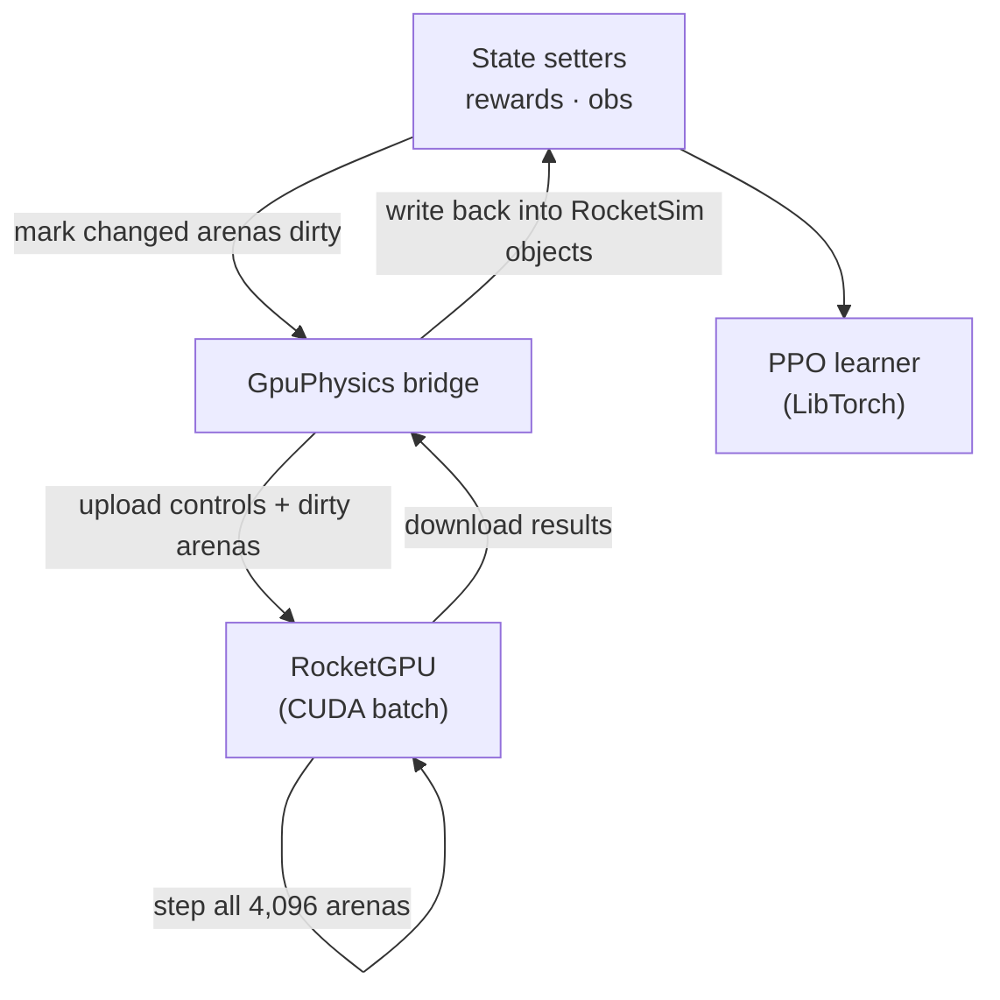

<p align="center">
  
</p>

<p align="center">
  
  
  
  
  
</p>

<h3 align="center">Train Rocket League bots on thousands of matches at once, on a single GPU.</h3>

---

## Why this exists

Reinforcement learning bots learn by playing an enormous number of games. In [GigaLearnCPP](https://github.com/ZealanL/GigaLearnCPP-Leak), each match runs its own copy of the RocketSim physics engine on the CPU. That puts a ceiling on how many matches you can run, and so on how fast your bot learns.

**GigaLearnGPU removes that ceiling.** It hands the physics for *every* match to [RocketGPU](https://github.com/thecosmicskye/RocketGPU), which steps them all together in one batch on the graphics card. Your rewards, observations and state setters stay exactly as they were.

## At a glance

| | |
|---|---|
| ⚡ **Throughput** | **160–200k steps per second** on average, end to end, including PPO training |
| 🏟️ **Arenas** | **4,096** simulated at once by default |
| 🖥️ **Hardware** | One RTX 3070 + Ryzen 7 2700X |
| 🧠 **Training setup** | 1v1, tick skip 8, 2 PPO epochs, 400k batch, 1024-wide network |
| 🔁 **Compatibility** | Turn the GPU path off and the original CPU path runs unchanged |

On the same machine, the original CPU RocketSim path reached only a small fraction of that throughput.

## How it works



The key idea is that **GigaLearn never has to know the GPU is there.**

1. **RocketSim objects stay the source of truth.** Every `Arena`, `Car` and `Ball` still exists on the CPU. They hold the state, but RocketSim's own physics step is never called.
2. **Only changed arenas are uploaded.** When a state setter resets an arena, the bridge marks it *dirty*, and only those arenas are sent to the GPU before the next step.
3. **One batched step.** RocketGPU advances every arena in a single CUDA batch.
4. **Results are written back.** Positions, velocities, tick counts and bump/demo events are copied back into the RocketSim objects. Rewards, observations and terminal conditions work exactly as before.

The bridge lives in [`GpuPhysics.h`](GigaLearnCPP/RLGymCPP/src/RLGymCPP/EnvSet/GpuPhysics.h) / `GpuPhysics.cpp`.

## What I added on top of GigaLearnCPP

- 🔌 **GPU physics bridge:** the `GpuPhysics` class and the `EnvSet` changes that switch between GPU and CPU stepping.
- 🪶 **Half-precision rollout inference** (`GIGALEARN_HALF_INFER`, on by default). Collecting experience runs in fp16 while training stays in fp32.
- ⏩ **Optional async PPO** (`GIGALEARN_ASYNC_PPO`): overlaps collecting experience with training.
- 🎓 **Guiding-policy (distillation) settings** in `PPOLearnerConfig`.
- 🪟 **Windows/MSVC fixes for RocketGPU:** a CUDA compiler crash workaround, an MSVC 128-bit multiply fix, and a way to upload one arena's ball without resetting all of them. Full details in [PATCHES.md](PATCHES.md).
- ⚖️ **A side-by-side checker** (`rg_compare`) that runs RocketGPU and RocketSim together to compare their results.

## Quick start

### Requirements

- Windows with **MSVC** and **Ninja**
- **CUDA toolkit 12.6+** (12.9 tested)
- **LibTorch** (CUDA build), unzipped into `GigaLearnCPP/libtorch`
- Python 3 (optional, for metrics)

### Build

```bat
git clone --recursive https://github.com/ConnorJosephDavies/GigaLearnGPU
cd GigaLearnGPU

:: 1. Build RocketGPU (produces RocketGPU/build/rocketgpu.lib)
cmake -S RocketGPU -B RocketGPU/build -G Ninja -DCMAKE_BUILD_TYPE=Release -DROCKETGPU_USE_CUDA=ON -DROCKETGPU_CPU_ISPC=OFF -DROCKETGPU_CUDA_SPLIT=OFF -DCMAKE_CUDA_ARCHITECTURES=86
cmake --build RocketGPU/build --target rocketgpu

:: 2. Build GigaLearn and the example trainer
cmake -S . -B build -G Ninja -DCMAKE_BUILD_TYPE=Release
cmake --build build
```

> **Pick the right GPU architecture:** `86` for RTX 30xx, `89` for RTX 40xx, `120` for RTX 50xx.
> To use a different CUDA install, set `ROCKETGPU_CUDA_ROOT` (it defaults to `%CUDA_PATH%`).

### Run

RocketSim needs collision meshes dumped from your own copy of Rocket League (see the [RocketSim docs](https://github.com/ZealanL/RocketSim)).

```bat
set ROCKETSIM_MESHES=C:\path\to\collision_meshes
set GIGALEARN_GPU_PHYSICS=1
build\GigaLearnExample.exe
```

[`src/ExampleMain.cpp`](src/ExampleMain.cpp) is a minimal 1v1 trainer using the stock rewards. Swap in your own rewards, observations and state setters exactly as you would in GigaLearnCPP.

<details>
<summary><b>⚙️ Configuration (environment variables)</b></summary>
<br/>

| Variable | Default | What it does |
|---|---|---|
| `GIGALEARN_GPU_PHYSICS` | off | `1` = step every arena in one RocketGPU batch |
| `GIGALEARN_NUM_GAMES` | 4096 (GPU) / 256 (CPU) | Number of arenas |
| `GIGALEARN_TS_PER_ITR` | 400k (GPU) / 50k (CPU) | Steps collected per PPO iteration |
| `GIGALEARN_HALF_INFER` | 1 | fp16 rollout inference |
| `GIGALEARN_ASYNC_PPO` | off | Overlap experience collection and training |

</details>

<details>
<summary><b>📁 Project layout</b></summary>
<br/>

```
GigaLearnGPU/
├── GigaLearnCPP/                 PPO learner (LibTorch)
│   └── RLGymCPP/
│       ├── src/RLGymCPP/EnvSet/  GpuPhysics bridge + EnvSet
│       └── RocketSim/            CPU physics (state containers)
├── RocketGPU/                    Batched CUDA physics (patched for MSVC)
│   └── gpusim_cmp/               RocketGPU vs RocketSim comparison tool
├── src/ExampleMain.cpp           Minimal 1v1 trainer
└── PATCHES.md                    Every change made to upstream code
```

</details>

## License

[PolyForm Noncommercial 1.0.0](LICENSE.md). You're free to use, modify and share it for personal, hobby, research or educational use, but not to sell it or use it commercially. Bundled third-party code (RocketGPU, RocketSim, Bullet and others) keeps its own license.

## Credits

This project stands on the shoulders of:

- **GigaLearnCPP and RLGymCPP** by ZealanL
- **RocketSim** by ZealanL (MIT)
- **RocketGPU** by Cosmic Skye (MIT; see `RocketGPU/LICENSE` and `RocketGPU/NOTICE`)
- **Bullet, nlohmann/json, thread-pool and pybind11**, each under its own license in its folder

<sub>An unofficial project, not affiliated with Psyonix or Epic Games.</sub>
